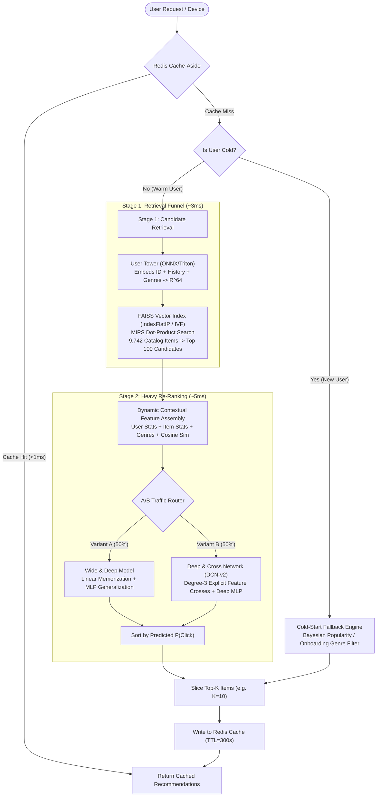
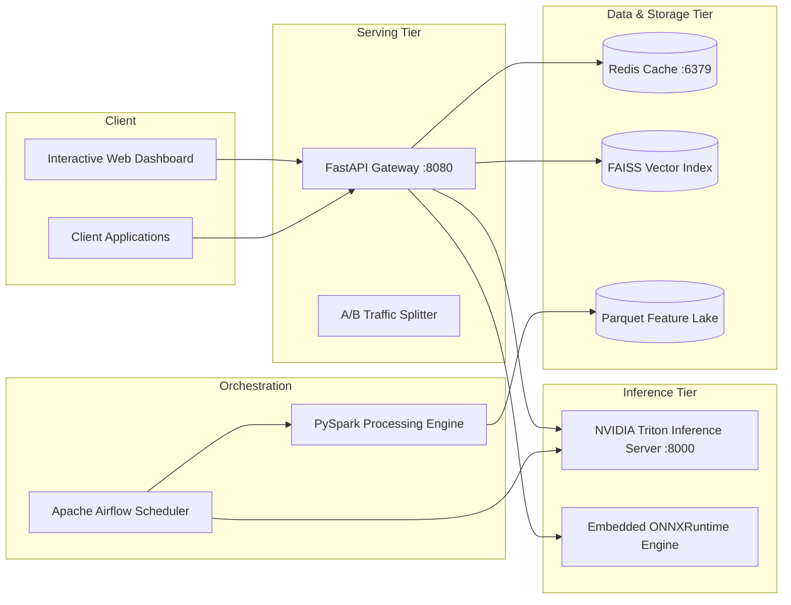

# System Architecture: Large-Scale Two-Stage Recommendation Engine

## 1. High-Level Architecture Overview

Modern industrial recommendation systems (e.g., Netflix, YouTube, Amazon) operate under strict latency budgets ($\le 50\text{--}100\,\text{ms}$) across catalogs consisting of millions of items. Evaluating a compute-heavy deep neural network across the entire catalog for every request is computationally impossible.

To resolve this, this system implements a classic **Two-Stage Funnel Architecture**:

---

## 2. Stage Breakdown & Algorithmic Details

### Stage 0: Cache-Aside Layer (Redis)
- **Key Pattern:** `rec:user:{user_id}:topk:{k}:{model_name}`
- **TTL Strategy:** 300 seconds (5 minutes) with automatic cache invalidation upon interaction events or retraining runs.
- **Failover:** Automatic, transparent failover to an internal LRU In-Memory store if the Redis daemon is offline.
- **Latency:** $\le 0.8\,\text{ms}$ on cache hit.

### Stage 1: Candidate Retrieval (Two-Tower & FAISS MIPS)
- **Goal:** Filter down the full catalog of items into the top 100 relevant candidates in under $5\,\text{ms}$.
- **User Tower:**
  - Inputs: User ID ($d=64$), historical genre preferences vector ($d=16$), normalized interaction frequency & average rating ($d=2$).
  - MLP: Dense ($192 \to 128$) $\to$ BatchNorm $\to$ ReLU $\to$ Dropout $\to$ Dense ($128 \to 64$).
  - Normalization: $L_2$ unit hypersphere projection: $\vec{u} = \frac{f_{\text{user}}(x)}{\|f_{\text{user}}(x)\|_2}$.
- **Item Tower:**
  - Inputs: Item ID ($d=64$), multi-hot genre vector ($d=16$), item popularity, average rating, normalized release year ($d=3$).
  - MLP: Dense ($192 \to 128$) $\to$ BatchNorm $\to$ ReLU $\to$ Dropout $\to$ Dense ($128 \to 64$).
  - Normalization: $L_2$ unit hypersphere projection: $\vec{v} = \frac{f_{\text{item}}(y)}{\|f_{\text{item}}(y)\|_2}$.
- **Contrastive Objective:** In-batch sampled softmax loss with temperature scaling ($\tau = 0.07$):
  $$\mathcal{L} = -\frac{1}{B} \sum_{i=1}^B \log \frac{\exp(\vec{u}_i \cdot \vec{v}_i / \tau)}{\sum_{j=1}^B \exp(\vec{u}_i \cdot \vec{v}_j / \tau)}$$
- **FAISS Vector Index:** Item vectors pre-indexed into `faiss.IndexFlatIP` (Exact Maximum Inner Product Search) and `faiss.IndexIVFFlat` for billion-scale catalogs.

### Stage 2: Heavy Re-Ranking (DCN-v2 vs Wide & Deep)
- **Goal:** Precisely re-score and re-order the 100 retrieved candidates using fine-grained contextual interactions.
- **Model A: Deep & Cross Network (DCN-v2):**
  - **Explicit Cross Network:**
    $$\mathbf{x}_{l+1} = \mathbf{x}_0 \odot (\mathbf{W}_l \mathbf{x}_l + \mathbf{b}_l) + \mathbf{x}_l$$
    Captures degree-$d$ explicit feature crosses at layer $d$ with linear computational complexity $\mathcal{O}(d)$.
  - **Deep MLP:** $128 \to 64 \to 32$ with BatchNorm and Dropout.
  - **Combination Layer:** Stacked concatenation predicting conversion probability $P(\text{click} \mid \text{user}, \text{item}, \text{context}) \in [0, 1]$.
- **Model B: Wide & Deep Network (Google 2016):**
  - **Wide Linear:** Memorizes direct associations between sparse features.
  - **Deep Feedforward:** Generalizes to unseen feature combinations.
  - Log-odds combination with sigmoid output.

---

## 3. Cold-Start Handling Strategy

1. **Pure Cold User (No profile, no history):**
   - **Bayesian Weighted Popularity:**
     $$\text{WR} = \left(\frac{v}{v+m}\right) R + \left(\frac{m}{v+m}\right) C$$
     where $v$ is vote/interaction count, $R$ is average item rating, $C$ is global mean rating, and $m$ is the 85th percentile popularity threshold.
   - **Diversity Constraint:** Enforces maximum representation caps per genre (max 15 items per genre) to avoid popularity echo chambers.
2. **Onboarding Cold User (Selected 1--3 genres at registration):**
   - Matches user onboarding genres with multi-hot item genres.
   - Ranks matched items by combined relevance score and Bayesian quality.

---

## 4. Serving & Deployment Architecture

- **Inference Redundancy:** FastAPI connects to Triton Inference Server via HTTP/gRPC. If Triton is absent in local dev/testing environments, it automatically uses identical ONNX graphs via embedded ONNXRuntime sessions.
- **Retraining Orchestration:** Apache Airflow DAG orchestrates the end-to-end retraining lifecycle on a cron schedule (`0 2 * * *`).
